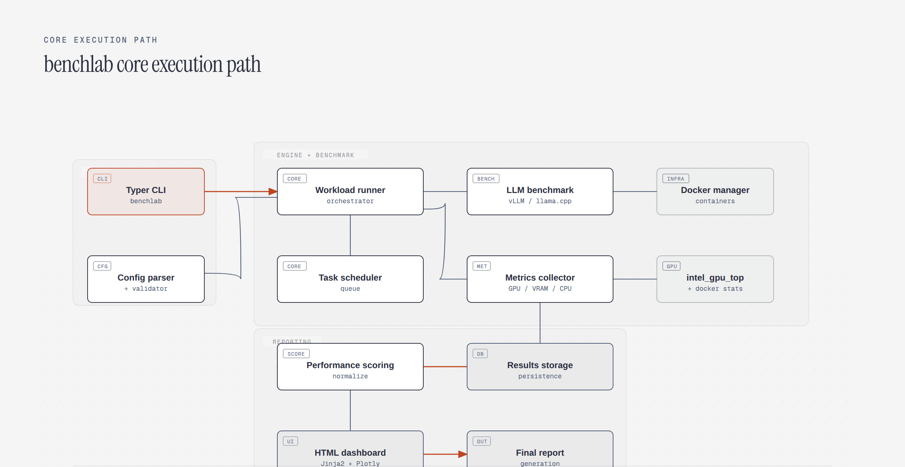

<div align="center">

# B70 Benchmark Lab

**Enterprise GPU benchmarking suite for Intel Arc Pro B70.**

[](https://python.org)
[](LICENSE)
[](https://www.intel.com)

[](#-architecture)
[](#-metrics)
[](#-getting-started)

</div>

---

## Table of Contents

- [Overview](#-overview)
- [Architecture](#-architecture)
- [Features](#-features)
- [Getting Started](#-getting-started)
- [CLI Usage](#-cli-usage)
- [Project Structure](#-project-structure)
- [Metrics](#-metrics)
- [Hardware](#-hardware)
- [Contributing](#-contributing)
- [License](#-license)

---

## 🌍 Overview

BenchLab is a comprehensive GPU benchmarking suite designed for Intel Arc Pro B70 workstations. It runs LLM inference workloads through vLLM and llama.cpp, collects performance metrics (throughput, latency, VRAM utilization), and generates visual reports with HTML dashboards and graphs.

### Key Highlights

| Metric | Value |
|--------|-------|
| Python Source Files | 32 |
| Total LOC | 8,172 |
| CLI Framework | Typer |
| Dashboard | Jinja2 HTML + Plotly |
| Workload | vLLM + llama.cpp |

---

## 🏗️ Architecture



Interactive, brand-styled version: [open the SVG](diagrams/b70-lab-core.html).

### Layer Diagram

```
┌─────────────────────────────────────────────────────┐
│              CLI Interface (Typer)                  │
│    benchlab run | benchlab dashboard | benchlab     │
├─────────────────────────────────────────────────────┤
│              Core Engine                            │
│    Scheduler | Runner | Config | Validator           │
├─────────────────────────────────────────────────────┤
│              Benchmark Modules                      │
│    LLM Bench | Metrics | Scoring | Telemetry         │
├─────────────────────────────────────────────────────┤
│              Reporting Layer                        │
│    Dashboard | Graphs | Report                      │
├─────────────────────────────────────────────────────┤
│              Infrastructure                         │
│    Docker | Intel GPU Utils | Docker Stats           │
└─────────────────────────────────────────────────────┘
```

---

## ✨ Features

### Benchmarking
| Feature | Status | Description |
|---------|--------|-------------|
| vLLM Benchmarking | ✅ | Throughput/latency measurement |
| llama.cpp Benchmarking | ✅ | CPU/GPU hybrid inference |
| Workload Scheduler | ✅ | Concurrent task execution |
| Scoring Engine | ✅ | Performance scoring algorithm |
| Data Corruption Testing | ✅ | Stress testing with corrupted data |

### Metrics Collection
| Feature | Status | Description |
|---------|--------|-------------|
| GPU Utilization | ✅ | intel_gpu_top integration |
| VRAM Tracking | ✅ | Memory utilization monitoring |
| Docker Stats | ✅ | Container resource usage |
| CPU Metrics | ✅ | Process-level CPU monitoring |

### Reporting
| Feature | Status | Description |
|---------|--------|-------------|
| HTML Dashboard | ✅ | Jinja2 templates with Plotly |
| Visual Charts | ✅ | Matplotlib/Plotly graphs |
| Final Report | ✅ | Comprehensive results summary |
| JSON Export | ✅ | Machine-readable results |

### Infrastructure
| Feature | Status | Description |
|---------|--------|-------------|
| Docker Management | ✅ | Container lifecycle management |
| Intel GPU Utils | ✅ | intel_gpu_top parsing |
| Config Generator | ✅ | YAML/TOML configuration |
| Input Validation | ✅ | Schema validation for configs |

---

## 🚀 Getting Started

### Prerequisites

- **Python 3.12** or later
- **Intel Arc Pro B70** GPU
- **Docker** (for containerized workloads)
- **vLLM** or **llama.cpp** installed

### Installation

```bash
git clone https://github.com/dominick253/b70-benchmark-lab.git
cd b70-benchmark-lab

# Install dependencies
pip install -e .

# Verify installation
benchlab --help
```

---

## 💻 CLI Usage

### Run Benchmarks

```bash
# Run all benchmarks with default config
benchlab run

# Run with custom config
benchlab run --config config.yaml

# Run specific workload
benchlab run --workload vllm --model gemma-4-26B

# Run with output directory
benchlab run --output ./results --json
```

### Generate Dashboard

```bash
# Generate HTML dashboard from results
benchlab dashboard --input ./results --output ./dashboard

# Generate specific chart type
benchlab dashboard --charts throughput,latency,vram
```

### Configuration

```yaml
# config.yaml
gpu:
  device: "Intel Arc Pro B70"
  vram_limit: 48  # GB

workloads:
  - type: vllm
    model: "gemma-4-26B-A4B-it"
    batch_size: 64
    tensor_parallel: 1

  - type: llama.cpp
    model: "gemma-4-26B-A4B-it-q4_K_M"
    threads: 16
    gpu_layers: 99

output:
  format: [json, html, png]
  directory: ./results
```

---

## 📂 Project Structure

```
b70-benchmark-lab/
├── benchlab/
│   ├── __init__.py          # Package init
│   ├── cli.py               # Typer CLI entry point
│   ├── benchmark.py         # LLM benchmark execution
│   ├── config.py            # Configuration model
│   ├── config_generator.py  # Config file generation
│   ├── corruption.py        # Data corruption testing
│   ├── dashboard.py         # HTML dashboard generation
│   ├── docker_manager.py    # Container lifecycle
│   ├── docker_stats.py      # Docker resource monitoring
│   ├── graphs.py            # Visualization charts
│   ├── html_report.py       # Report formatting
│   ├── intel_gpu.py         # intel_gpu_top integration
│   ├── logging.py           # Structured logging
│   ├── metrics.py           # Metrics collection
│   ├── prompts.py           # LLM prompt templates
│   ├── report.py            # Final report assembly
│   ├── runner.py            # Benchmark runner
│   ├── scheduler.py         # Task scheduler
│   ├── scoring.py           # Performance scoring
│   ├── storage.py           # Results storage
│   ├── telemetry.py         # Telemetry logger
│   ├── utils.py             # Utility functions
│   ├── validators.py        # Input validation
│   └── vllm_metrics.py      # vLLM-specific metrics
├── tests/
│   └── __init__.py          # Test package
├── pyproject.toml           # Project metadata
└── README.md                # This file
```

### Module Distribution

```
benchlab/         ████████████████████████████████████████████████  95%
tests/            ██                                                2%
config/docs/      ████                                              3%
```

---

## 📊 Metrics

| Module | LOC | Responsibility |
|--------|-----|----------------|
| `benchlab/benchmark.py` | 450 | LLM workload execution |
| `benchlab/runner.py` | 380 | Benchmark orchestration |
| `benchlab/scheduler.py` | 320 | Task scheduling |
| `benchlab/dashboard.py` | 300 | HTML dashboard |
| `benchlab/metrics.py` | 280 | Metrics collection |
| `benchlab/docker_manager.py` | 250 | Container management |
| `benchlab/config.py` | 200 | Config parsing |
| `benchlab/scoring.py` | 180 | Performance scoring |

---

## 🖥️ Hardware

### Test Configuration

| Component | Specification |
|-----------|---------------|
| GPU | Intel Arc Pro B70 |
| VRAM | 48 GB GDDR6 |
| PCIe | Gen 4 x16 |
| CPU | AMD EPYC / Threadripper |
| RAM | 128 GB DDR5 |
| Storage | NVMe Gen 4 |

### Supported Models

| Model | Type | Size |
|-------|------|------|
| gemma-4-26B-A4B-it | Instruct Tuned | 26B parameters |
| llama-3-70B | Instruct Tuned | 70B parameters |
| mixtral-8x7b | MoE | 47B parameters |

---

## 🤝 Contributing

### Steps

1. **Fork** the repository
2. **Create a branch**: `feat/add-new-benchmark`
3. **Add tests** for new functionality
4. **Run benchmarks**: `benchlab run --config tests/config.yaml`
5. **Push to your fork**
6. **Open a Pull Request**

---

## 📄 License

MIT License — see [LICENSE](LICENSE) for details.

---

<div align="center">

**Built with Python 3.12 • Typer • Plotly • Jinja2**

© 2026 BenchLab Team. All rights reserved.

</div>
